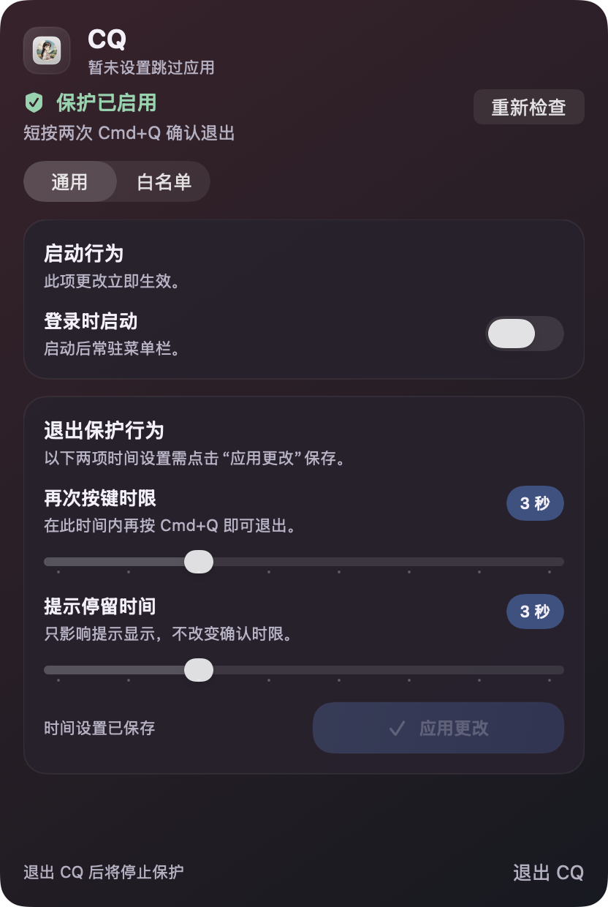
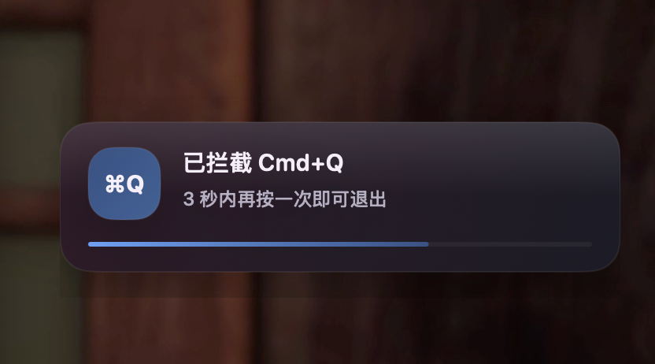

# CQ

CQ 是一个 macOS 菜单栏工具，用来拦截误触的 `Cmd + Q`。

默认情况下，按下一次 `Cmd + Q` 不会立刻退出应用；只有在设定时间内再次触发，才会真正退出。这样可以在日常工作里减少误关应用的情况。

## 功能

- 拦截单次 `Cmd + Q`
- 支持双击确认退出
- 短按 `Cmd + Q` 由 CQ 二次确认，长按重复事件会透传给前台应用，兼容 Chrome 这类自带长按退出确认的应用
- 支持登录时启动
- 支持白名单应用跳过二次确认
- 支持在菜单栏面板内直接调整常用设置

## 使用方式

1. 启动应用后，图标会常驻在菜单栏。
2. 点击菜单栏图标，打开设置面板。
3. 根据需要调整退出确认时间、提示停留时间或白名单应用。
4. 菜单顶部显示实际保护状态；出现权限或拦截异常时，点击“重新检查”尝试恢复。
5. 一般保持默认设置即可。

## mac mini / 多设备排查

当某台设备出现“`CQ` 进程还在，但 `Cmd + Q` 不再被拦截”时，请优先按下面顺序排查：

1. 先确认应用进程仍在运行：
   `pgrep -fal CQ`
2. 再确认权限状态：
   辅助功能、输入监控 / 事件监听都需要已授权。
3. 如果权限看起来正常，再检查诊断文件。当前启用 App Sandbox，通常位于：
   `~/Library/Containers/com.yanque.CQ/Data/Library/Application Support/CQ/quit-guard-diagnostics.json`
   非沙箱本地运行时位于 `~/Library/Application Support/CQ/quit-guard-diagnostics.json`。实际位置以系统返回的应用支持目录为准。
4. 最后再检查应用签名与环境状态：
   `codesign --verify --deep --strict /Applications/CQ.app`

诊断文件会记录：

- 当前进程 `pid`
- 当前应用路径与 bundle id
- 权限快照
- tap 创建策略、尝试结果与最近失败原因
- 代码签名状态
- 声明的 sandbox 状态
- 推断出的主要失败原因

如果诊断文件里已经提示权限满足，但 `suspectedFailureReason` 仍然是 `invalidCodeSignature`、`tapCreateReturnedNil`、`tapEnableFailed` 或 `declaredSandboxButUnavailable`，请先点击菜单中的“重新检查”，必要时按系统提示重启，再核对诊断结果。反复重启仍无法建立 tap 时应视为验收失败，不能仅凭进程存在或权限已勾选判定保护生效。

本地白名单与诊断 JSON 的读取上限为 1 MiB。超限文件会被拒绝处理，白名单原文件不会被覆盖；可在备份后检查文件内容并重试。

## 开发说明

- 本地跑单测时建议关闭签名校验，避免被已撤销证书影响：
  `xcodebuild test -project CQ.xcodeproj -scheme CQ -destination 'platform=macOS' CODE_SIGNING_ALLOWED=NO CODE_SIGNING_REQUIRED=NO CODE_SIGN_IDENTITY='' -only-testing:CQTests`
- 如果要定位退出保护问题，优先查看统一日志和上面的诊断文件，两边会输出同一套事件名：
  `launch_sync`、`wake_sync`、`manual_sync`、`permission_refresh`、`tap_create_attempt`、`tap_create_result`、`tap_disabled`、`tap_recovery_result`、`environment_diagnosed`

## 质量验收清单

自动化覆盖见 [CQTests](CQTests/CQTests.swift)。测试构造事件对象但不向其他应用发送按键；界面通过不可见窗口离屏检查。无签名单测、离屏图像和本地临时签名检查都不代替正式签名包及真实系统授权验收。

| 检查域 | 本地检查与回归覆盖 | 真实环境需确认 |
| --- | --- | --- |
| 按键 | 首次、二次、长按、重复事件、16 种修饰键组合、松键顺序、US/French/Dvorak 布局数据 | 应用实际收到的快捷键与原生长按退出行为 |
| 身份与期限 | 同一进程/路径快照、切换/返回、未知身份、截止边界、主队列延迟 | 快速应用切换下的实际事件路由 |
| event tap | 创建/启用失败、实际启用检查、重复恢复、主动停止、迟到回调、端口析构 | 正式沙箱环境能否真实建立并持续使用 tap |
| 权限与系统 | 撤销/恢复编排、旧状态过滤、休眠/唤醒、无变化健康检查不重建或落盘 | TCC 授权、系统要求重启的情况、真实睡眠恢复 |
| 重启与自启动 | 成功、失败保留原进程、重复请求、待批准、取消、状态回读 | LaunchServices 新实例交接与登录启动 |
| 白名单与配置 | 缺失、损坏、写入失败/重试、符号链接、去重、异常类型/数值、1 MiB 文件边界 | 沙箱内实际持久化与应用路径命中 |
| 应用列表 | 搜索、选择、Finder 取消、安装/卸载刷新、慢扫描关闭重开、旧结果隔离 | 标准目录和手动选择应用的可访问性 |
| 界面 | 菜单/设置共享模型，错误、过期、延迟和动画状态；离屏布局 | 菜单实际操作、多屏/全屏显示和焦点 |
| 工程与资源 | 回归测试、Release 构建、端口/任务清理、共享缓存互斥、有界读写 | 正式发行签名、版本/构建号及发布渠道检查 |

### 人工验收：待执行

由维护者在独立测试账户或机器上，用本轮最终代码对应的正式签名候选包执行。先备份白名单与配置，只使用可随时关闭的空白测试应用。不要对正在工作的应用发送退出快捷键。

1. **包与版本**：按现有发行流程核对签名、App Sandbox、Bundle ID、版本和构建号，执行 `codesign --verify --deep --strict /Applications/CQ.app`。当前工程版本为 `1.5 (1)`，既有 Git 标签 `1.5` 保持原样；正式上传前必须确认构建号未被占用，并记录候选包实际对应的提交。
2. **首次授权**：未授权时菜单必须明确显示未启用。完成辅助功能和输入监控授权；系统要求重启时先重启。点击“重新检查”，只有真实拦截可用才允许显示已启用。若权限满足但 tap 无法建立，记录诊断文件和系统日志，判定本项失败。
3. **按键与切换**：首次短按拦截，期限内第二次才放行，期限外重新确认；长按交由应用处理，松开后重新开始。分别验证先松 Command、剩余 Shift/Control/Option 的情况。A 应用的确认不能用于 B，切出再切回也应重新确认。使用 French/Dvorak 时验证逻辑 Q，不得误拦截 Cmd+A 等其他快捷键。
4. **权限与睡眠**：撤销权限后不得持续显示已启用；恢复授权后重新检查。后台检查目标周期为 5 秒，主线程负载可能使执行延后。睡眠/唤醒后再次验证实际拦截；恢复失败必须显示失败，不能以日志中的历史成功代替当前结果。
5. **重启与登录启动**：连续点击重启最终只保留一个 CQ 实例，且新实例能保护退出。验证登录启动开关、系统待批准提示、取消待批准注册，以及独立测试账户重新登录后的实际启动。
6. **白名单与界面**：新增、移除并重启确认持久化；验证普通应用和 Safari 等链接应用。列表刷新后应反映安装/卸载，不能自动枚举的应用用 Finder 手动选择并验证命中。菜单与设置窗口修改应一致；确认过期时不能继续提示“再按一次即可退出”。多屏/全屏场景提示应可见且不抢输入焦点。

记录候选包对应提交、macOS 版本、每项结果及失败时的诊断。只有上述人工项也通过，才能认定整体验收完成；本地自动化通过仅表示本地质量收敛，不保证不存在未知缺陷。

## 界面预览

<table>
  <tr>
    <td align="center" width="50%">
      
       
      菜单栏界面
    </td>
    <td align="center" width="50%">
      
       
      触发弹窗
    </td>
  </tr>
</table>
